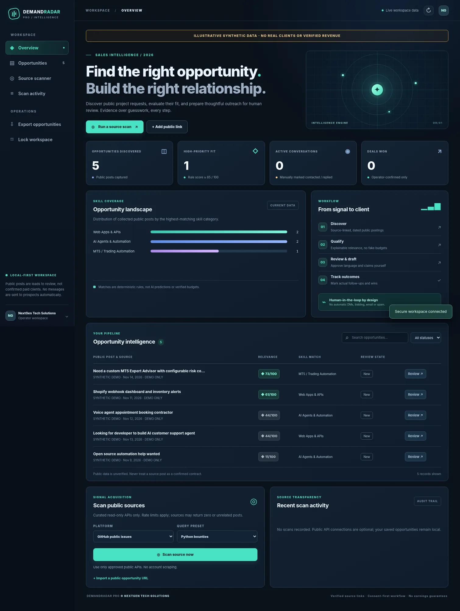

# DemandRadar Pro

**Public-source opportunity intelligence for software agencies — with human-reviewed outreach.**



> **Status: working local prototype.** Two public read-only source adapters, SQLite pipeline, explainable fit scoring, editable proposal templates, optional API-backed AI writing, optional owner-only Telegram notifications, responsive dashboard, exports, authentication and CI. No external CRM, paid bidding platform account, automatic prospect messaging or revenue claims. All screenshots and demos use clearly marked synthetic examples.

## Why it exists

New digital-services companies need qualified conversations, not another collection of repository links. DemandRadar is a small, inspectable operator desk to find **public posts** relevant to a team's skills, prioritize them with transparent reasons, read the source, and draft a response that a human must approve. It **does not assume a public issue is a job or that any poster has a verified budget**.

## What works today

| Capability | Implementation | Evidence / limitation |
|---|---|---|
| GitHub issue discovery | GitHub REST issue search, curated fixed queries | Live only when network/API quota available; many issues are unpaid contributions |
| Hacker News discovery | Public Algolia API index, curated fixed queries | Posts can be discussions, not confirmed jobs |
| Manual opportunity capture | Operator submits HTTPS link and exact public brief | Link is **stored, not fetched**; authenticity must be checked |
| Scoring | Deterministic keywords + explicit intent, age and budget mentions | Score means **relative fit**, NOT win probability, income or verified compensation |
| Pipeline | SQLite upsert, idempotency, preserved statuses, audit records | Operator marks contacted/replied/won manually |
| Proposal writing | Editable template with relevant public GitHub reference | Draft only; no auto-sending |
| Optional AI drafts | OpenAI Responses API with explicit operator click | Requires your own API key; off by default; prompt injection safeguards are not perfect |
| Owner notifications | Telegram Bot API | Only when operator explicitly clicks and configures their own chat |
| CSV export | Formula-injection protected CSV | User-triggered local export only |
| Dashboard | Responsive no-CDN HTML, CSS and vanilla JS | No public SaaS user accounts, billing or multi-tenancy |
| CI | Automated unit/API tests, offline synthetic demonstration and wheel check | Offline tests are not production integration certification |

## Quick start (Python 3.11+)

```bash
git clone https://github.com/rajachanna/DemandRadar-Pro.git
cd DemandRadar-Pro
python -m venv .venv
# Activate your environment, then:
python -m pip install -e '.[dev]'
cp .env.example .env
python -c "import secrets; print(secrets.token_urlsafe(32))"
```

Replace `DR_OPERATOR_KEY` with the generated value. **Do not use the example placeholder or commit .env.** Export the variables in your shell or load `.env` locally before starting (the app deliberately does not auto-load hidden files). Example for Linux/macOS:

```bash
set -a; . ./.env; set +a
python -m demandradar.cli --host 127.0.0.1 --port 8090
```

Open [http://127.0.0.1:8090](http://127.0.0.1:8090) and enter your operator key. Windows PowerShell: set `$env:DR_OPERATOR_KEY="your-generated-key"` and run the same Python command. Other providers are optional; `GITHUB_TOKEN` raises GitHub search API quotas subject to provider terms.

**Docker** (localhost by default): copy `.env.example` to `.env`, supply a strong key, then `docker compose up --build -d`. The included Compose port is bound to `127.0.0.1` intentionally. For internet exposure use a TLS reverse proxy, additional rate-limiting, external auth/network restrictions and proper backups, before calling it production-ready.

## Supported operator workflow

1. Log in with the private operator key. Dashboard responses are not available anonymously.
2. Choose a curated GitHub issue or Hacker News public discussion search. No account scraping, no LinkedIn/Fiverr/Upwork automation and no arbitrary URL fetching.
3. Open a record's canonical public link, manually verify that it represents a real paid opportunity and complies with the platform's posting/contact rules.
4. Shortlist or archive it; document findings. Generate and **edit** a template or optional AI draft only if contacting the poster is appropriate.
5. Send a message **manually** in an authorized channel, then optionally mark contacted/replied/won and track results honestly. No sending capability to prospects is implemented.
6. Export local records to CSV or send a notification **only to your configured Telegram owner chat** with explicit approval.

**Live source failures** (403/429/timeouts/API shifts) show in the scan log and do not manufacture opportunities. Do not infer there is no demand from a zero-result scan. The GitHub API may rate-limit unauthenticated queries. Use official provider documentation and authorized API credentials where needed.

## API routes

Operator-only endpoints require an `X-Operator-Key` header with `DR_OPERATOR_KEY` (24+ characters).

| Method | Route | Purpose |
|---|---|---|
| GET | `/health` | Public health and demo status |
| GET | `/api/session` | Verify operator key and available optional connectors |
| GET | `/api/summary`, `/api/opportunities`, `/api/scans` | Private reporting |
| POST | `/api/scan` | One curated public search (GitHub or HN) |
| POST | `/api/opportunities/import` | Save one manual public link |
| PATCH | `/api/opportunities/{id}/status` | Review state and operator notes |
| POST | `/api/opportunities/{id}/draft` | Human-review template or optional AI draft |
| POST | `/api/alerts/telegram` | Manually notify configured owner Telegram chat |
| GET | `/api/exports/opportunities.csv` | Operator CSV export |

## Screenshots and demonstrations

- `docs/assets/dashboard-preview.webp` — static screenshot from **explicitly seeded synthetic** local data, never a real client list.
- `python scripts/demo.py` — offline temporary database with five artificial opportunity records, deduplication check and metrics; no external network, money or real-world messages.
- `DR_DEMO_MODE=true DR_DB_PATH=./data/preview.sqlite python scripts/seed_dashboard.py --yes-synthetic` — optional explicit demonstration data for a local screenshot environment. Never point this at a production database.

## Security and integrity

- Operator key is compared using constant-time comparison, required for every private API action, and held only in browser session storage; use private machine/network boundaries.
- Static dashboard scripts are served locally with restrictive content security policy and HTML escaping.
- Only fixed upstream GitHub and Hacker News hosts are contacted. Imported URLs are stored, never fetched; no arbitrary SSRF requests.
- Public-post email addresses and phone numbers are redacted from stored text; no bulk contact harvesting.
- Stored records are deduplicated, operator review state preserved, and scan errors logged without API secrets.
- CSV output protects spreadsheet formula prefixes.
- AI content is untrusted, optional, reviewed by a human and never sent automatically. The optional model call sends public post details to the selected AI provider (`store:false`), so obtain appropriate consent or avoid using it for confidential material.
- No hidden claims of guaranteed clients, revenue, job availability, live trades or production third-party integrations.

See [SECURITY.md](SECURITY.md) for operational boundaries and [docs/CASE_STUDY.md](docs/CASE_STUDY.md) for engineering decisions.

## Client-acquisition strategy

Deploy this operator tool internally, not as a public unauthenticated scanner. Use verified public work samples to support proposals, while growing a trusted public agency website with relevant service pages, real case studies, search performance measurement and a working contact funnel. **The project does not replace direct sales or guarantee opportunities.**

Developed as an engineering proof of concept for NextGen Tech Solutions.
